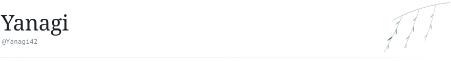

<!-- Generated by scripts/generate.py from profile.json -->

<picture>
  <source media="(prefers-color-scheme: dark)" srcset="./assets/header-dark.svg" />
  <source media="(prefers-color-scheme: light)" srcset="./assets/header-light.svg" />
  
</picture>

### 最近在做

- **[SubVault](https://github.com/Yanagi42/SubVault)**（[在线演示](https://yanagi42.github.io/SubVault/)） &nbsp;`Rust` `SQLite`
   本地加密的订阅与账单凭证库。原始 PDF 和网页回执按内容哈希留存去重，随时可以导出带 SHA-256 校验的离线包。

- **[gauge](https://github.com/Yanagi42/gauge)** &nbsp;`Rust` `Direct2D` `Python`
   严格只读、零联网的多 Agent Windows 本地 Token、费用与配额仪表盘。原生聚合 Antigravity、Claude Code、Codex CLI 与 Gemini CLI，用 Direct2D 绘出悬浮胶囊与详情面板，配套 `/statusline` 桥接和零依赖 CLI。
